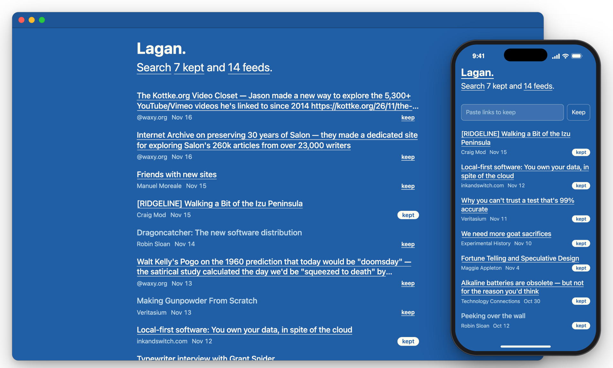

> lagan /ˈlæɡən/ _noun_
>
> goods cast into the sea with a buoy tied to them, so they can be found again.

Lagan is an old word of maritime law: of what is lost at sea, flotsam floats, jetsam sinks, and lagan sinks with a buoy marking where it lies.

Lagan is a feed tracker for one person. It follows RSS, Atom and JSON feeds, YouTube channels and Bluesky accounts, and shows the hundred posts that arrived last, newest first, as plain pages that load at once on a phone. What you keep is your lagan: marked, and there when you come back for it, with links pasted in from anywhere. There is no unread count; a link you opened is just a different colour.

- **Follow** a feed from its link, a site's link, or a handle. Lagan finds the feed, shows what it found before following, and opens it with its posts.
- **Edit** a feed in place: its name, its address, words that hide its posts, and text taken out of its titles.
- **Search** feeds by name and posts by title.
- **OPML** to bring feeds in from another reader, or take them out.
- **`lagan`**, a command line that does all of it, and runs the app at login.

It's one Bun process and one SQLite file, with no build step.



## Installation

On a Mac, with [Bun](https://bun.com):

```sh
git clone <this repo> lagan && cd lagan
bun install
bun link        # the lagan command, run from this copy
lagan install   # runs Lagan at login, and starts it now
```

`lagan install` writes a launch agent, `~/Library/LaunchAgents/org.sk.lagan.plist`, pointing at this copy. It starts the app, waits until it answers and prints its address. From then on Lagan starts at login, and again if it stops.

| Command           | What it does                                     |
| ----------------- | ------------------------------------------------ |
| `lagan install`   | Run at login, from this copy, and start now      |
| `lagan restart`   | Restart, after pulling or changing the code      |
| `lagan uninstall` | Stop, and no longer run at login; the data stays |

`lagan` alone lists the rest: following, keeping, muting, OPML.

To remove it all: `lagan uninstall`, `bun unlink`, then delete the folder.

## Where things live

Everything is in this copy of the repo, and none of it is in git:

- `data/lagan.sqlite`: every feed, post and setting, made on the first start.
- `data/server.log`: what the running app prints.
- `.env`, if you need one: where Lagan listens. Without it, at `http://127.0.0.1:8789/`.

```sh
LAGAN_HOST=127.0.0.1
LAGAN_PORT=8789
SITE_PATH=/lagan   # when a proxy serves it under a path
```

## On your other devices

Lagan has no accounts or passwords: it listens only on this Mac, and is for whoever can reach it. [Tailscale](https://tailscale.com) can bring it to your other devices, and only to them. With `SITE_PATH=/lagan` in `.env`, once:

```sh
tailscale serve --bg --set-path /lagan http://127.0.0.1:8789/lagan
```

Lagan is then at `https://<this mac>.<your tailnet>.ts.net/lagan`, over HTTPS, from any device on your tailnet. Tailscale keeps this across restarts; `tailscale serve --set-path /lagan off` takes it away.

## Working on it

```sh
bun run dev     # reloads on change
bun test
bun run check && bun run lint && bun run format
```
